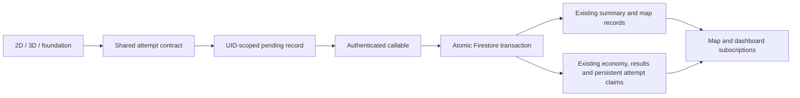

# Task 6 — local integration draft (not rollout-ready)

No production reads, writes, migrations, rule application, deployments or Git pushes were performed.
The clean starting branch was `feat/khmer-first-touch-typing-curriculum` at `256f153d`.
Cached `origin/main` was `69be1a47` (PR #20); the remote PR #21 merge was not verified.
Work is on `feat/secure-student-progress-integration`.

## Audit and architecture

Previously, 2D completion independently wrote the whole `students/{uid}/progress/summary`,
`students/{uid}/lessonProgress/{world}:{level}`, and economy under `users/{uid}`.
Summary/map writes were not atomic with rewards. Some promises were discarded; an economy
failure said it would retry without a queue. Whole-summary writes could lose another device's
updates. Map snapshots could replace optimistic records. Timestamp-based economy result IDs
did not prevent first-clear duplication across modes. Global summary/map browser caches were
not account-scoped. Owner-write rules allowed forged balances and arbitrary nested claims.
3D used memory adapters; foundation deliberately skipped permanent persistence.



`completionContract.ts` resolves historical structured IDs to existing map identities. Some
historical structured IDs map many-to-one; they are preserved rather than renumbered.
`1:1` is shared by 2D and 3D. `foundation-home-row` is separate and excluded from map subscriptions.
New accepted passes append the canonical ID and the first legacy route alias to the summary.
Unknown historical completion IDs remain. No production migration is included.

## Server boundary and reward policy

The callable derives UID from Firebase Auth and rejects anonymous sessions. Admin SDK is
restricted at module startup to `demo-khmer-typing` plus Firestore emulator configuration.
Client configuration is likewise explicitly emulator-only for this draft's callable.
The endpoint rejects unexpected top-level/metric fields, oversized inputs, unknown curriculum,
unsupported 3D lessons, missing stage passes, malformed counters, and locked lessons.

Each UUID attempt has a persistent `users/{uid}/rewardClaims/attempt-{uuid}` record containing
a payload hash and response. Identical retries return the committed response; altered reuse
fails. Transactions serialize concurrent calls and update summary, map bests, balance, result,
and claim together. Existing first-steps, accuracy, no-mistake and streak economy achievements
are claimed atomically, and lesson/accuracy/star daily quest progress is incremented once per attempt. Different attempts have a three-second submission interval.

The existing pure reward calculator was extracted to `rewardPolicy.ts` for reuse on the server.
Existing standard rewards include pass, accuracy, stars, speed, improvement, and streak bonuses.
This draft bounds repeat-practice awards to five attempts per UTC server day, caps XP and coins
at 500 per attempt, and allows first-clear gem bonuses once across modes. First clears are
eligible even after the daily repeat allowance. Retry of one committed attempt consumes no
additional allowance. Worse scores cannot replace map bests. Existing balances are merged.
This bounded replay policy needs product review before rollout.

## Foundation and learning evidence

3D foundation submissions include five stage results and the existing reported practice summary:
physical correct counts, virtual assistance, key positions, strong/weak keys, and expected guidance.
These are client reports; the browser cannot verify actual finger placement. Virtual assistance
is not physical mastery. Physical-key metrics must be interpreted separately from Unicode CPM.
2D foundation units now retain stage IDs, include the hand-position practice stage, and track
per-stage errors and reported physical/virtual practice. All five stage thresholds must pass
before saving a completed foundation record. A full browser playthrough remains unverified. No keyboard mappings or Unicode segmentation changed.

## Sessions, offline state and compatibility

Summary/map caches now use UID suffixes and reject stale account snapshots. Existing ambiguous
unscoped browser caches are not imported into authenticated accounts. Server data is retained.
Successful snapshots feed the existing map/dashboard. Server summary history is preserved; full new attempts also remain in `users/{uid}/lessonResults`.
Very large historical summaries may reach Firestore document limits; scalable history pagination
needs a follow-up before broad rollout. A failed transaction preserves previous history.

Authenticated standard 2D saves bypass the old three-write path. 3D keeps gameplay independent
of database operations and submits after stage aggregation. Pending rewards display zero until
acknowledged. Failed attempts remain in a maximum-20-entry UID-scoped localStorage outbox with
stable IDs. Retry is explicit, online-only, and stops on account change. No background retry or
automatic reward grant occurs. Storage-full errors are surfaced. Demo gameplay retains its
existing local behavior. Production saves are intentionally disabled pending backend review.

Rules draft denies all client writes under both student/user trees, including nested collections.
Owner-only reads remain. Legacy boss heart spending, shop purchases, quests, profile writes,
and privileged achievement claims still need trusted endpoints; these will fail under this
rules draft. Consequently **do not deploy this rules file** as a standalone update.
Existing deployed rules have not been changed by this work.

## Local setup and tests

Prerequisites: Node 22 (Functions runtime), Java 21+, npm dependencies, emulator binaries.
Use synthetic accounts only. No service-account keys or real student exports.

```
npm install
npm run build:functions
npm run typecheck:functions
npm run test:emulators
```

`test:emulators` starts Auth/Firestore/Functions with explicit `--project demo-khmer-typing`,
runs the security/callable tests and stops them. Interactive use:

```
npx firebase emulators:start --project demo-khmer-typing --only auth,firestore,functions
```

Stop with Ctrl+C. For offline browser QA, set `VITE_LOCAL_DEMO=true` (development only) to disable Firebase even if local configuration exists.
Run Vite with `VITE_USE_FIREBASE_EMULATORS=true` in an ignored `.env.local`.
All three client SDKs connect to loopback emulators before use; the demo project replaces live
config. Never use that flag in a production build. Tests require emulator environment variables
and refuse another project. Firebase CLI/Java/emulator downloads require network approval.

Run `npm run typecheck`, `npm run lint`, `npm test`, `npm run build` plus the backend and emulator
checks. `completionTests.mjs` covers identity aliases, foundation isolation, invalid/forged fields,
unsupported modes and incomplete stages. `firebaseIntegrationTests.mjs` covers private reads,
direct/nested write rejection and concurrent authenticated callable idempotency.

## Remaining blockers and anti-cheat limits

This draft is **not Task 6 acceptance-complete**. Cross-device browser verification, full failure-scenario emulator
coverage, full foundation browser verification, complete badge/achievement/quest server integration, trusted
boss/shop/profile endpoints, special adaptive practice identity, and exhaustive failure/session
tests remain. 3D currently invokes the shared service from page orchestration; the existing
memory adapter remains for debug/session bookkeeping. Full adapter replacement is unfinished.
There is no server-issued exercise challenge or keystroke proof; plausible fabricated metrics
can pass validation. Payload hashes prevent replay duplication, not cheating. Stage reports and
reported physical/virtual evidence are untrusted. More exhaustive evidence consistency checks,
rate limits, App Check and monitoring require a separate backend hardening pass.

## Deployment, costs and rollback

No staging or production deployment is proposed until these blockers are resolved. A future
rollout requires reviewed Functions setup, billing eligibility (typically Blaze), Node runtime,
region/data-residency decisions, App Check policy, quotas/budgets, rules tests and fresh staging
browser verification. Functions invocation/compute and Firestore reads/writes may incur costs;
this implementation queries all map records per completion, so read cost scales with history.
Emulators have no Firebase billing usage, but downloads require network access.

Roll out trusted endpoints first, then compatible clients, then restricted rules together with
all affected operations. Review older clients: they cannot continue owner-authoritative rewards.
Back up reviewed rules/config and export only through a separately approved migration procedure.
Rollback should disable completion submissions while keeping server-owned balances and reads;
never restore broad owner reward writes as a security rollback. No destructive migration or
automatic data rewrite is supplied. Obtain explicit approval for every production operation.

## Verification record (2026-10-31)

- Frontend typecheck (both configs), lint, typing/gamification/3D/contract tests and production build passed.
- Functions bundle and strict backend TypeScript passed.
- Initial demo emulator suite passed: owner/private reads, unauthenticated and cross-user denial,
  protected and nested client-write rejection, callable authentication, forged field rejection,
  concurrent duplicate submission and changed-content replay rejection.
- Playwright smoke passed with Firebase explicitly disabled: guest entry, 3D exploration/canvas,
  2D Khmer KeyK accepted as first input (1/55, zero mistakes), locked 3D lesson rejected with no canvas.
  Full stage playthrough and cross-device authenticated browser synchronization were not verified.
- Emulator ran on host Node 26 despite configured deployment runtime 22; repeat on Node 22 before rollout.
- Initial tooling downloads failed with ECONNRESET; bounded retries succeeded. Java was downloaded
  only into ignored `.local`; emulator CLI used isolated XDG config/cache and explicit demo project.
- Dependency installation reported 47 audit findings (3 low, 33 moderate, 10 high, 1 critical).
  These have not been triaged or automatically fixed; dependency review remains before rollout.
- No production deployment, rules application, student migration or Git push was executed.

## Changed files

Configuration: `.gitignore`, `eslint.config.js`, `package.json`, `package-lock.json`, `firebase.json`,
`firestore.rules`, `tsconfig.functions.json`, `vite.config.ts`, `src/vite-env.d.ts`,
`src/config/environment.ts`, `src/lib/firebase.ts`.

Backend/contracts: `functions/package.json`, `functions/index.ts`, `src/lib/completionContract.ts`,
`src/lib/lessonCompletion.ts`, `src/lib/rewardPolicy.ts`.

Integration: `src/components/lesson/LessonWorldScreen.tsx`,
`src/components/lesson/CompletionSaveStatus.tsx`, `src/pages/ThreePrototypePage.tsx`,
`src/lib/studentProgress.ts`, `src/data/mockData.tsx`, `src/lib/economy.ts`,
`src/lib/lessonTypingPlan.ts`.

Tests/build: `scripts/buildFunctions.mjs`, `scripts/completionTests.mjs`,
`scripts/firebaseIntegrationTests.mjs`.

Documentation: this file and `docs/firestore-security-rules.md`.

The expanded emulator suite also passed cross-mode replay, best-score preservation, locked submission denial, and separate foundation completion before the final achievement/quest additions. Those additions are covered by the final rerun.

Final expanded emulator run passed, including exact first-step coin and accuracy-gem rewards, replay achievement deduplication, best-score preservation, locked lessons, and independent foundation identity. Emulators shut down after the run. Local changes remain uncommitted for review.
