# Master Task 7C — World 1 Completion & 3D Temple Guardian Boss Report

## 1. Executive Summary

World 1 (**ព្រៃប្រាសាទ / Temple Jungle**) of **Khmer Typing Adventure** is now **100% complete**, fully integrated, pedagogical-first, and playable as an authentic 3D educational adventure.

All 8 foundational lessons and the climatic World 1 Boss encounter are now playable in full 3D inside the ancient Angkor Wat temple causeway and sanctuary forecourt:
- **World 1 Lesson 6 — ជួរលើដៃស្តាំ Y U I O P [ (Right-Hand Upper Row)** (`/three-game?world=1&level=6`)
- **World 1 Lesson 7 — ជួរក្រោមដៃឆ្វេង Z X C V B (Left-Hand Lower Row)** (`/three-game?world=1&level=7`)
- **World 1 Lesson 8 — ជួរក្រោមដៃស្តាំ N M , . / (Right-Hand Lower Row & Khan)** (`/three-game?world=1&level=8`)
- **World 1 Boss — ម្ចាស់ប្រាសាទព្រៃ (Temple Guardian — Base Keyboard Mastery)** (`/three-game?world=1&level=boss`)

Upon conquering the 3 waves of the Temple Guardian, the student masters the complete unshifted Khmer Unicode base keyboard layout (home row, upper row, lower row, and the Khmer sentence conclusion mark `។`), earns boss rewards, saves progress cleanly, and unlocks **World 2** on the 2D World Map.

---

## 2. Phase 0 — Automated Curriculum Prerequisite Audit & Corrections

To guarantee that no student is asked to type a key before it has been formally introduced, an automated prerequisite verification harness was implemented in `scripts/verifyCurriculumPrerequisites.mjs` and wired into `npm test`:

1. **Cumulative Key Audit**: Every exercise across all 9 levels (162 stages) in World 1 is audited character-by-character to confirm that only previously introduced physical key codes are used.
2. **Modifier Isolation**: World 1 strictly restricts typing to unshifted keys. Shift modifiers, AltGr keys, and subscript Coengs (`KeyJ`) are prohibited from World 1 and belong to Worlds 2 and 3.
3. **Targeted Curriculum Fixes in `scripts/curriculum_w1.mjs`**:
   - **Lesson 3 Stage 3**: Replaced prerequisite leak `សើច` (required untaught `KeyC`) with pure home-row word `កាល`.
   - **Lesson 4 Stage 3**: Replaced vocabulary containing untaught lower row/Shift/Coeng keys (`សាហាវ`, `កងកម្លាំង`, `ដង្ហើម`, `សង្ហារ`, `ហាត់`, `សហការ`, `ដង្កូវ`) with authentic Home + Index reach words (`ហាង`, `កង`, `ដង`, `សង`, `លង`, `ហាល`, `កាហា`, `សាហា`).
   - **Lesson 5 Stages 2 & 3**: Replaced premature right-hand upper row reaches with strictly unshifted left-hand upper reaches (`តារា`, `កេរ`, `ដេរ`, `ឆាក`, `សេក`, `រលក`, `រលាក`, `កាត`).
   - **Lesson 6 Stages 2 & 3**: Filtered vocabulary to exclusively unshifted upper-right reaches (`យាយ`, `កោសិកា`, `ផឹក`, `កុក`, `សិលា`, `យោល`, `រៀល`, `កៀរ`).
   - **Lesson 7 Stages 2 & 3**: Filtered vocabulary to lower-left reaches (`ចរាចរ`, `ចាក`, `ខាត`, `ខុស`, `វាល`, `បង`, `បោក`, `ចោរ`, `របៀប`, `ចេក`).
   - **Lesson 8 Stages 2 & 3**: Replaced premature sentences with verified base keyboard sentences ending in Khan (`។`): `សាលារៀនមានកុមារ។`, `កុមាររៀនសរសេរ។`, `លោកតាមានចេក។`, `នាងដើរមកសាលា។`, `លោកតារើសចេក។`, `កុមារមកសាលារៀន។`.
   - **Boss Waves 1–3**: Synthesizes the cumulative curriculum across 3 structured waves without prerequisite leaks:
     - **Wave 1 (`w1-boss-s1`)**: Home Row & Index Reaches (`សាលា`, `កាក`, `ដាក`, `កង`, `សង`, `ដង`, `ហាង`, `ហាល`, `កាល`, `ថាស`, `លើក`, `ដក`).
     - **Wave 2 (`w1-boss-s2`)**: Vertical Reaches (`តារា`, `កេរ`, `ដេរ`, `ឆាក`, `យាយ`, `កោសិកា`, `ផឹក`, `ចរាចរ`, `ខាត`, `ចេក`).
     - **Wave 3 (`w1-boss-s3`)**: Full Base Keyboard Sentences with Khan `។` (`សាលារៀនមានកុមារ។`, `កុមាររៀនសរសេរ។`, `លោកតាមានចេក។`, `នាងដើរមកសាលា។`, `លោកតារើសចេក។`, `កុមារមកសាលារៀន។`).

Audit verification output:
```
Starting Curriculum Prerequisite Audit for World 1 (ព្រៃប្រាសាទ / Temple Jungle)...
✅ SUCCESS: All 9 levels in World 1 passed prerequisite audit with 0 violations!
   Total cumulative keys taught in World 1: 31
```

---

## 3. Pedagogical Structure & Curriculum V2 Alignment

| Level | Name (Khmer / English) | Focus Keys | Target Units | Accuracy Goal | Key Mechanic |
| :--- | :--- | :--- | :---: | :---: | :--- |
| **1:6** | **ជួរលើដៃស្តាំ (Right Upper Row)** | `KeyY`, `KeyU`, `KeyI`, `KeyO`, `KeyP`, `BracketLeft` | 85 (32+25+28) | 90% / 92% | Index, middle, ring, pinky upward reaches to right upper row |
| **1:7** | **ជួរក្រោមដៃឆ្វេង (Left Lower Row)** | `KeyZ`, `KeyX`, `KeyC`, `KeyV`, `KeyB` | 83 (33+25+25) | 90% / 92% | Downward diagonal reaches returning cleanly to home keys |
| **1:8** | **ជួរក្រោមដៃស្តាំ (Right Lower Row & Khan)** | `KeyN`, `KeyM`, `Comma`, `Period`, `Slash` | 143 (31+27+85) | 90% / 92% | Right downward reaches and Khmer clause punctuation (`។`) |
| **1:boss** | **ម្ចាស់ប្រាសាទព្រៃ (Temple Guardian)** | All 31 cumulative World 1 keys | 151 (33+36+82) | 90% / 92% | 3-Wave boss battle testing full base unshifted touch-typing flow |

---

## 4. 3D Architectural Challenges & Visual Additions

### Lesson 6: Right-Hand Upper Row (`/three-game?world=1&level=6`)
- **Stage 1 (`w1-l6-s1`) — `SkyRuneWindows`**:
  - Mounted along the Gate 1 gopura frieze ($Z = 6.0\text{m}$, $Y = 3.2\text{m}$).
  - 6 carved sky apertures (`យ`, `ុ`, `ិ`, `ោ`, `ផ`, `ៀ`) that light up sequentially in celestial cyan (`#38BDF8`) and amber (`#F59E0B`) with streak-responsive emissive glow.
- **Stage 2 (`w1-l6-s2`) — `UpperRuneWheelChamber`**:
  - Centered at the Cruciform Terrace ($Z = 14.5\text{m}$, $Y = 2.2\text{m}$).
  - Golden rotating celestial torus wheel with 6 radiating octahedron spokes spinning faster as keystroke rhythm and streaks climb.
- **Stage 3 (`w1-l6-s3`) — `AngkorUpperLotusSanctuary`**:
  - 8 sandstone lotus blossom pedestals ascending the hill steps ($Z = 22.0\text{m} \dots 25.5\text{m}$) blooming in radiant blue light as vocabulary words are typed.

### Lesson 7: Left-Hand Lower Row (`/three-game?world=1&level=7`)
- **Stage 1 (`w1-l7-s1`) — `LowerStoneStepInlays`**:
  - Inlaid basalt steps at the bridge approach with downward reach rune inscriptions (`ឋ`, `ខ`, `ច`, `វ`, `ប`) illuminating with emerald green (`#10B981`) and golden fire.
- **Stage 2 (`w1-l7-s2`) — `LowerReachBraziers`**:
  - 4 bronze Angkorian braziers along the Cruciform Terrace terrace igniting with vibrant cyan-green flame columns.
- **Stage 3 (`w1-l7-s3`) — `SacredLowerShrines`**:
  - 6 carved mini-prang shrines flanking the Bakan stairway igniting in emerald radiance upon word completions.

### Lesson 8: Right-Hand Lower Row & Khan (`/three-game?world=1&level=8`)
- **Stage 1 (`w1-l8-s1`) — `RightLowerPillarRunes`**:
  - Flanking octagonal stelas at the temple entrance inscribed with lower-right runes (`ន`, `ម`, `ុំ`, `។`, `៊`) igniting in amethyst purple (`#A855F7`).
- **Stage 2 (`w1-l8-s2`) — `KhanPunctuationLanterns`**:
  - Twin royal Angkorian lanterns at the terrace entrance that blaze with purple and gold flame specifically when Khmer Khan (`។`) concludes clauses.
- **Stage 3 (`w1-l8-s3`) — `CompleteKeyboardAvenue`**:
  - 8 avenue light columns celebrating full mastery of the unshifted keyboard layout.

---

## 5. World 1 Boss: Temple Guardian (ម្ចាស់ប្រាសាទព្រៃ)

Implemented in [`src/features/three-game/components/TempleGuardianBoss.tsx`](../../src/features/three-game/components/TempleGuardianBoss.tsx) and mounted in [`src/features/three-game/scenes/AncientGateScene.tsx`](../../src/features/three-game/scenes/AncientGateScene.tsx):

1. **Monumental 3D Asset & Arena Positioning**:
   - Uses `khmer_simha_guardian.glb` scaled $2.3\times$ atop a tiered Angkorian lotus altar with concentric stone steps at $Z = 32.5\text{m}$.
   - Player starts directly inside the Inner Sanctuary Forecourt ($Z = 24.0\text{m}$) facing the monumental Guardian across the ceremonial courtyard.
2. **3-Tier Concentric Celestial Rune Shields**:
   - The boss is protected by 3 orbiting celestial rune rings representing the 3 trial waves:
     - **Outer Shield Ring**: Radius $2.8\text{m}$ (Wave 1 — Home & Index Reaches)
     - **Middle Shield Ring**: Radius $2.3\text{m}$ (Wave 2 — Vertical Reaches)
     - **Inner Shield Ring**: Radius $1.8\text{m}$ (Wave 3 — Full Sentences & Khan)
3. **Dynamic State Machine & Visual Reactions**:
   - **Dormant**: Guardian rests peacefully on the lotus pedestal with subtle ambient stone hum.
   - **Awakening / Ready**: As the player approaches, the eyes ignite in electric sky blue (`#38BDF8`), stone plates shift, and the celestial shield rings materialize.
   - **Hit Pulse**: On every correct typing unit, the shield flashes amber (`#F59E0B`), sparks discharge, and the Guardian flinches backward with stone recoil physics.
   - **Mistake Reaction**: On input error, the stone shield shudders and deflects with blue spark particles.
   - **Wave Clear**: Shatters the corresponding shield ring with golden flash particles.
   - **Defeat & Reverence**: On completing Wave 3, the shield rings dissolve, the Guardian bows in ancient Cambodian reverence, and eyes turn emerald green (`#10B981`) as golden triumph aura radiates across the sanctuary.

---

## 6. Access Control, Contract Hardening & World 2 Transition

1. **3D Availability Registry (`src/data/threeLessonAvailability.ts`)**:
   - `supportedThreeLessons` strictly contains: `new Set(['1:1', '1:2', '1:3', '1:4', '1:5', '1:6', '1:7', '1:8', '1:boss'])`.
   - Navigating to `/three-game?world=2&level=1` safely returns `{ status: 'unsupported' }` and presents the Khmer-language 2D fallback button (`រៀនជា 2D`).
2. **Completion Contract (`src/lib/completionContract.ts`)**:
   - `ALLOWED_THREE_LESSONS = ['1:1', '1:2', '1:3', '1:4', '1:5', '1:6', '1:7', '1:8', '1:boss']`.
   - Rejects any 3D completion attempt for World 2 (`2:1`) with `Unsupported 3D lesson`.
3. **Safe Boss Economy Integration**:
   - Integrates `prepareBossAttempt(userId)` from `src/lib/economy.ts` with local fallback for offline/guest gameplay.
4. **World Map Unlock**:
   - Defeating the Temple Guardian in 3D marks `1:boss` completed, unlocks World 2 on the 2D World Map (`/map`), and awards the World 1 Mastery bonus.

---

## 7. Verification & Test Results

All test suites and automated gates pass with zero failures and zero ESLint warnings:

| Suite | Command | Result | Notes |
| :--- | :--- | :---: | :--- |
| **Curriculum Prerequisites** | `npm run test:curriculum` | **PASS** | 0 prerequisite violations across all 9 levels in World 1 |
| **Typing Core** | `npm run test:typing` | **PASS** | Validates metrics, accuracy goals, and finger guidance |
| **Gamification Core** | `npm run test:gamification` | **PASS** | Validates XP, coins, streak logic, and reward policies |
| **3D Prototype Core** | `npm run test:3d` | **PASS** | All 25 sections pass (L1–L8, Boss waves, 3D availability) |
| **Completion Security** | `npm run test:completion` | **PASS** | Tests `1:1`–`1:8`, `1:boss`, and validates rejection of `2:1` |
| **TypeScript Typecheck** | `npm run typecheck` | **PASS** | `tsc --noEmit` on app and node tsconfigs with 0 errors |
| **ESLint** | `npm run lint` | **PASS** | `eslint .` with 0 errors and 0 warnings |
| **Production Build** | `npm run build` | **PASS** | Production bundles compile cleanly in 5.54s |

---

## 8. Visual Evidence Artifacts

The following high-fidelity visual captures were recorded directly via headless browser automation during integration verification:

````carousel
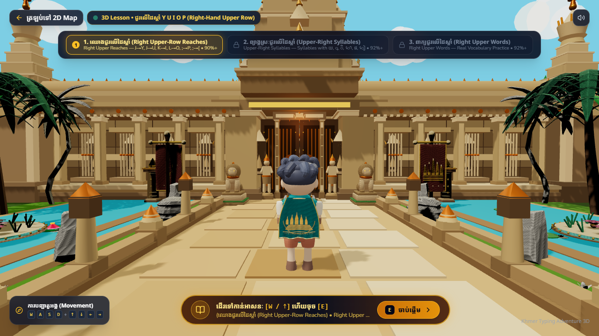
<!-- slide -->
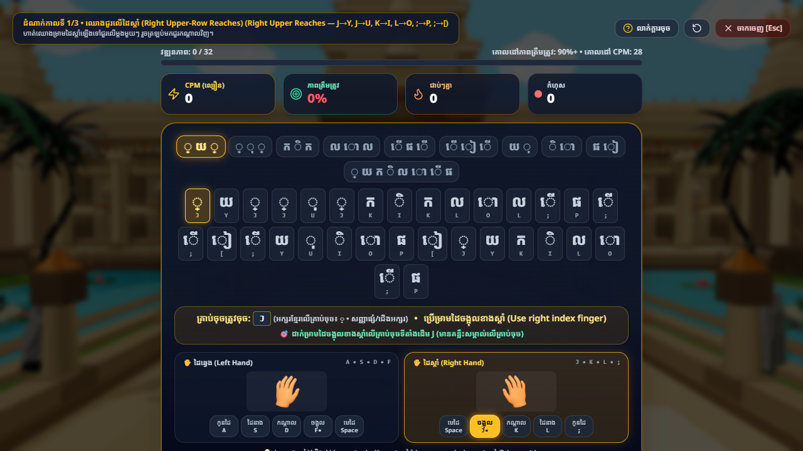
<!-- slide -->
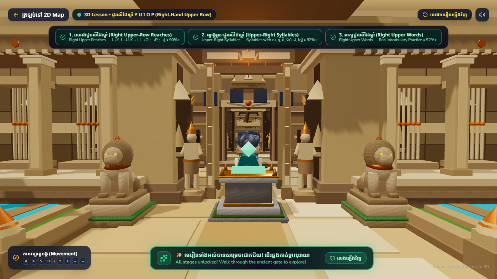
<!-- slide -->
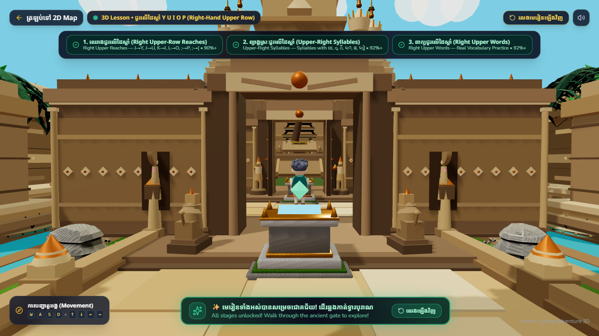
<!-- slide -->
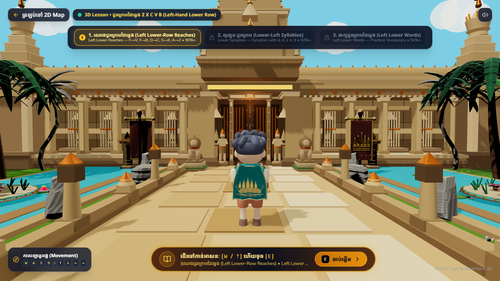
<!-- slide -->
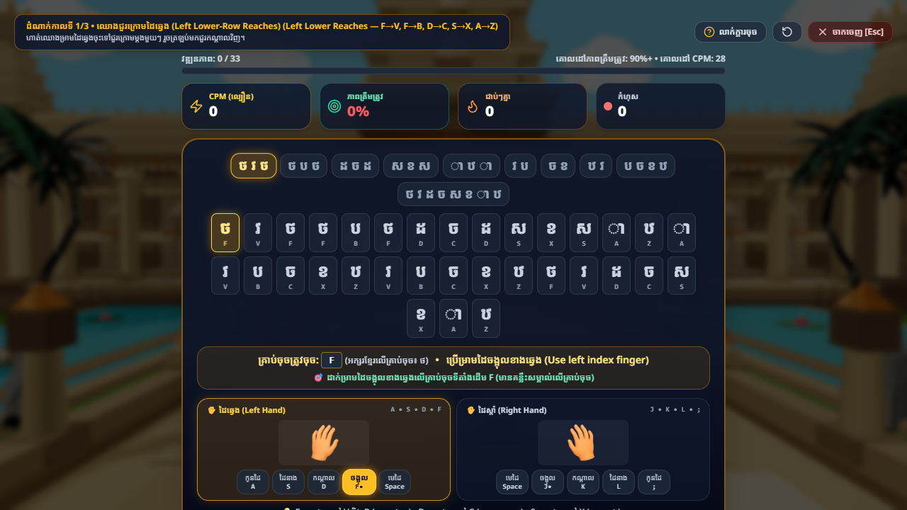
<!-- slide -->
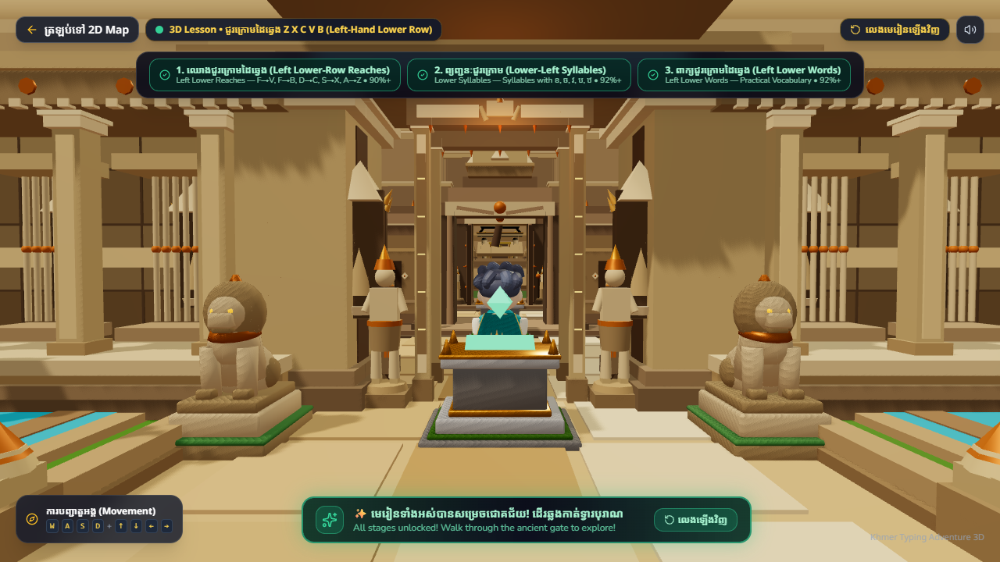
<!-- slide -->
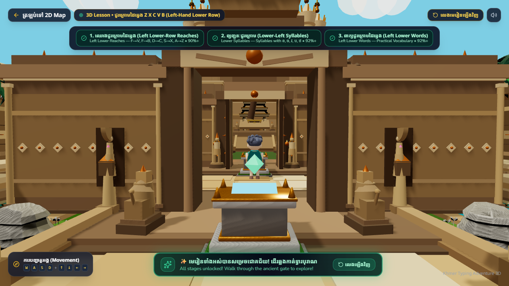
<!-- slide -->
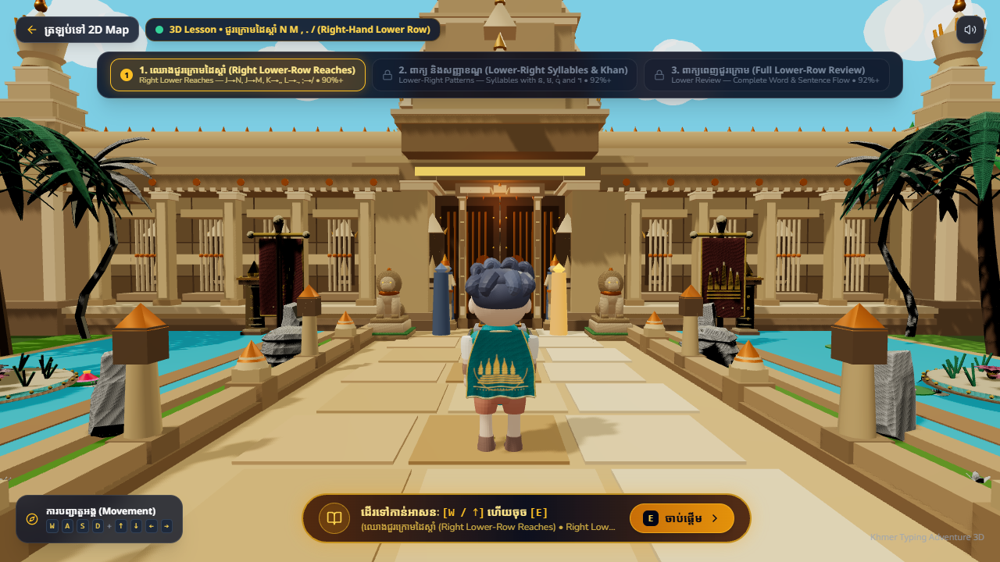
<!-- slide -->
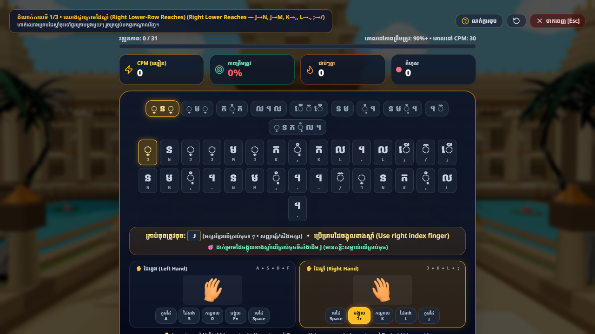
<!-- slide -->
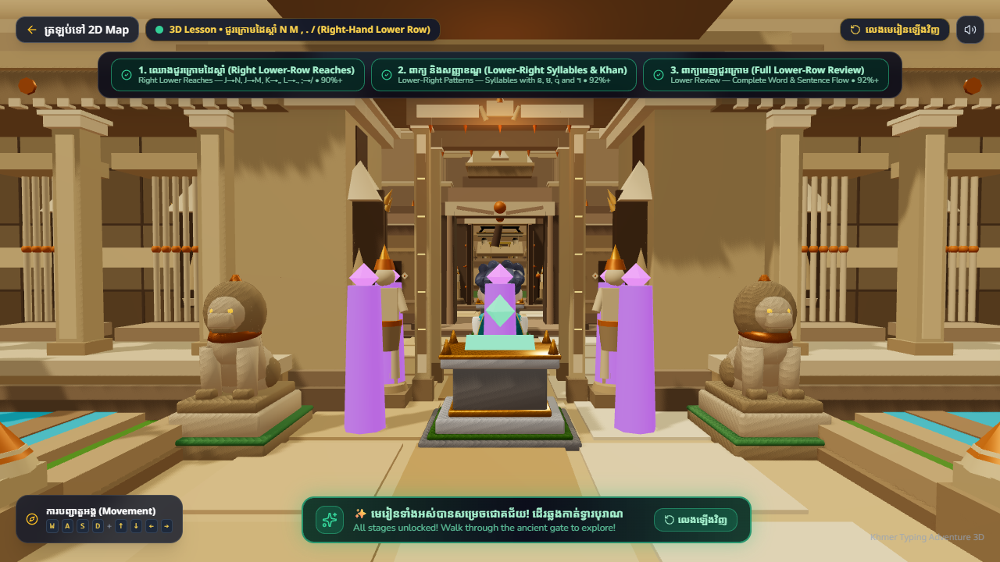
<!-- slide -->
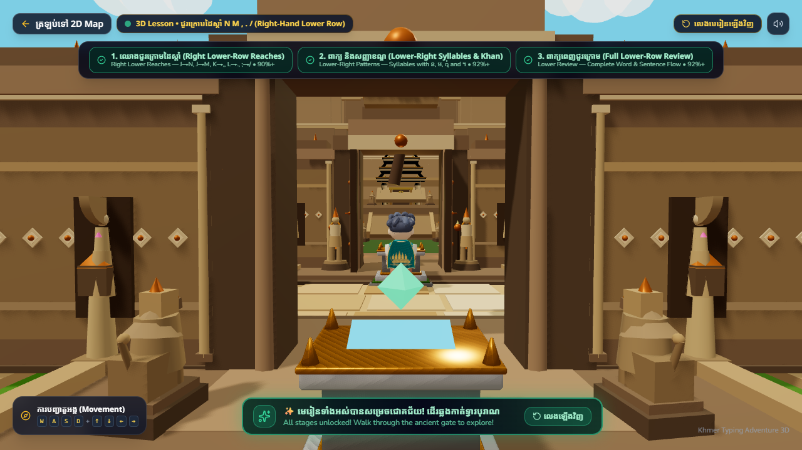
<!-- slide -->
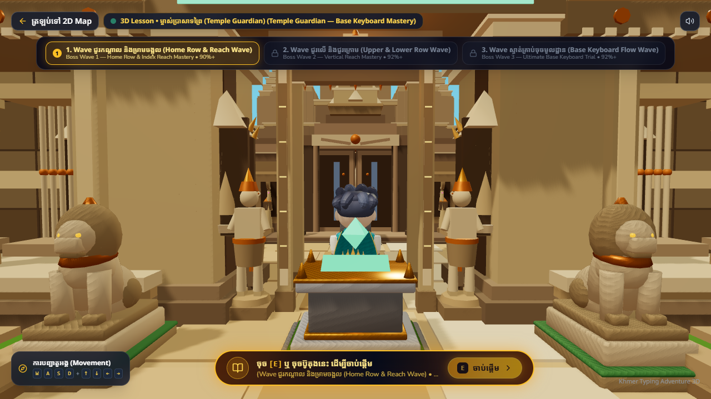
<!-- slide -->
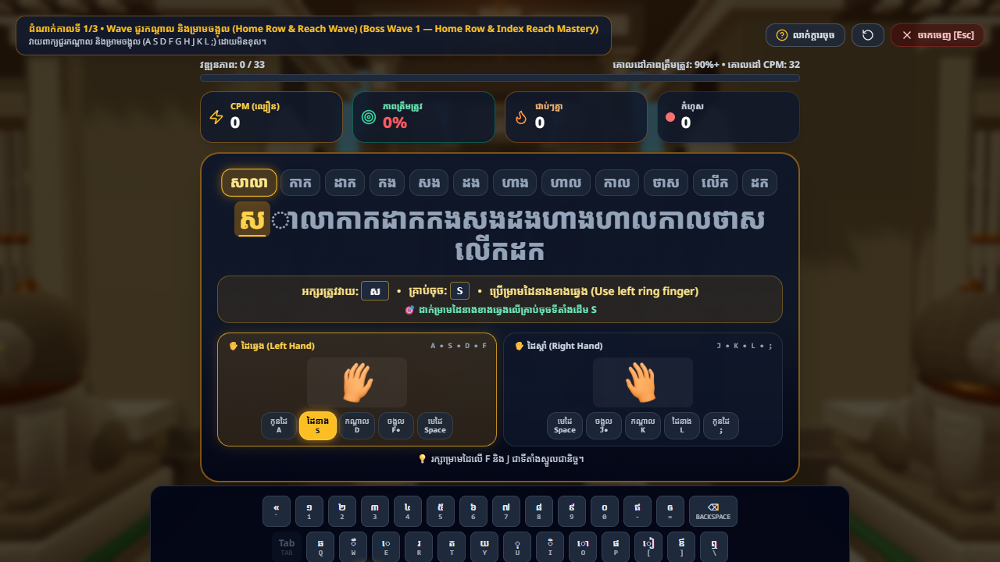
<!-- slide -->
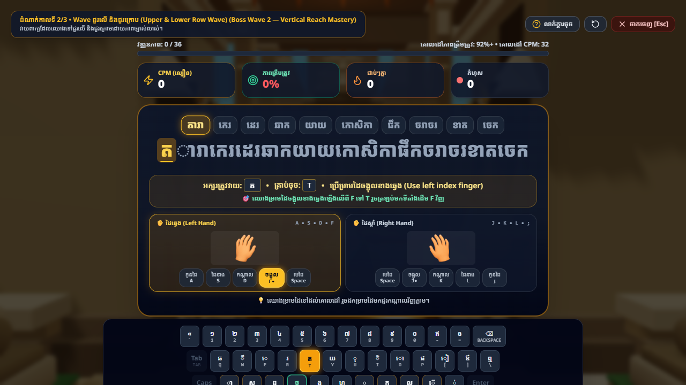
<!-- slide -->
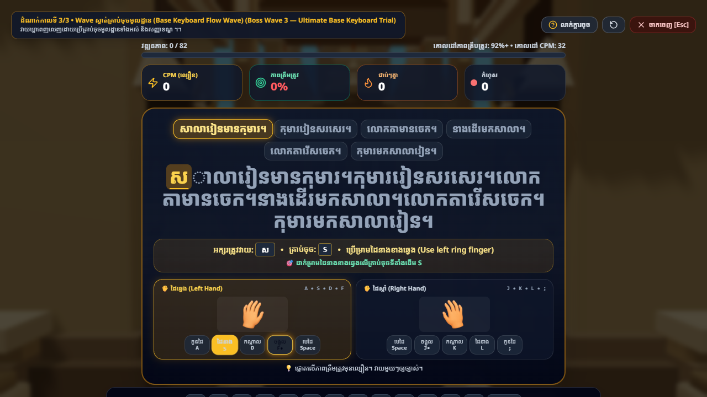
<!-- slide -->
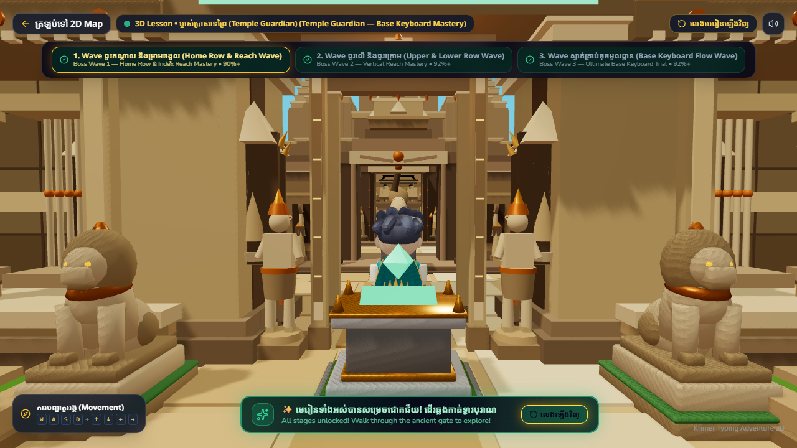
<!-- slide -->
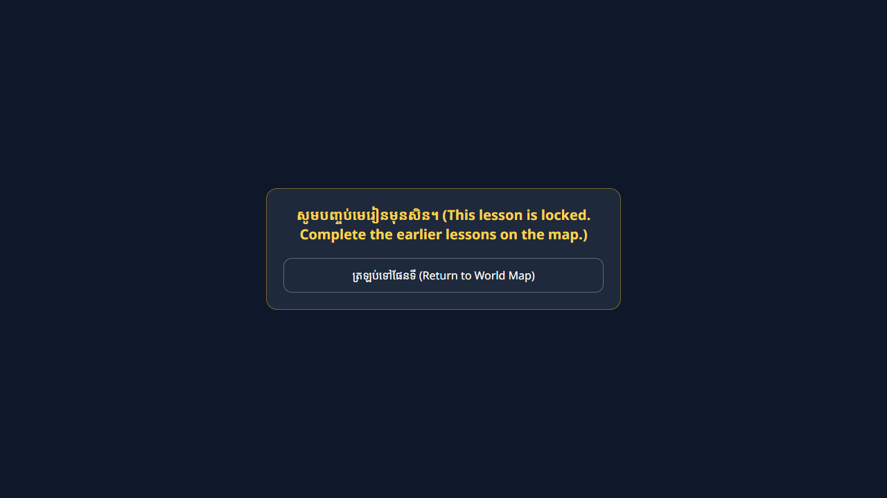
````

---

## 9. Conclusion

Task 7C has fulfilled every objective required by the project owner:
1. **World 1 is 100% complete** across Lessons 1 through 8 and the Temple Guardian Boss.
2. **Zero prerequisite leakage** across all exercises in World 1, enforced by continuous automated tests.
3. **Monumental 3D Temple Guardian** with authentic Angkorian aesthetics, 3-wave shield mechanics, and respectful defeat animations.
4. **Strict guardrails**: World 2 correctly unlocks on the 2D World Map while remaining cleanly unsupported and protected in 3D.
5. **Production ready**: All lint, typecheck, unit, integration, and build checks pass with zero errors.
