# Task 7C.0 — World 1 Complete 3D Gameplay Variety Report

**Repository:** [https://github.com/rak190/Khmer_Typing_adventure](https://github.com/rak190/Khmer_Typing_adventure)  
**Branch:** `feat/task-7c-0-gameplay-variety`  
**Date:** November 2026  
**Status:** All Checkpoints (A, B, C, D, E) Complete & Verified  

---

## 1. Executive Summary & Root Cause Analysis

### The Problem
During early playtesting of World 1, player feedback identified that while the underlying Khmer Unicode touch-typing curriculum was pedagogically sound and progressive, the 3D exploration experience felt repetitive and monotonous:
- **Identical Spatial Loop:** Every level reused the same linear stone causeway with identical physical barriers placed at roughly $Z = 6$, $Z = 16$, and $Z = 26$.
- **Predictable Routine:** Walk forward $\to$ approach identical altar $\to$ open typing overlay $\to$ unlock identical stone gate $\to$ walk forward $\to$ repeat.
- **Generic Quest HUD:** The exploration interface repeatedly displayed a generic prompt (*"ដើរទៅកាន់អាសនៈ [W/↑]"*) regardless of the lesson's unique educational theme.

### The Solution: Complete World 1 Experience Engine
We developed a data-driven **Lesson Experience Engine** and implemented **9 distinct 3D environments** across World 1 (Lessons 1 to 8 + Temple Guardian Boss):
1. **Level 1 (វិហារម្រាមបុរាណ / Ancient Finger Sanctuary):** A quadrangle courtyard where left-hand keys awaken 4 cardinal stelas (`F`, `D`, `S`, `A`) and a rotating central sun-dial mechanism.
2. **Level 2 (សួនផ្កាឈូកទិព្វ / Enchanted Lotus Garden):** Shallow reflective water courtyard with giant blooming lotus flower stepping pads (`J`, `K`, `L`, `;`).
3. **Level 3 (ស្ពានភ្លោះអង្គរ / Angkor Twin Bridges):** A deep misty chasm spanned by twin parallel causeways that unite through bilateral left/right hand coordination.
4. **Level 4 (ផ្លូវបំបែកព្រៃស្រោង / Jungle Crossroads):** Branching stone paths where index reaches (`G` and `H`) unlock the western grove trail and central shrine.
5. **Level 5 (ការឡើងប្រាសាទកំពូល / Climbing Temple Tower):** A vertical stepped Angkorian pyramid with dynamic real-time $Y$-axis character elevation and matching camera ascension.
6. **Level 6 (វេទិកាវេហាស៍ / Sky Platforms):** Floating stone platforms suspended in midair with glowing blue runic rings and celestial overlook disc.
7. **Level 7 (រូងថ្មគ្រីស្តាល់ / Crystal Cave):** Subterranean basalt chamber with giant glowing amethyst, sapphire, and emerald crystal clusters (`Z`, `X`, `C`, `V`).
8. **Level 8 (ការឆ្លងកាត់ស្ទឹងស័ក្តិសិទ្ធិ / Sacred River Crossing):** Sacred Baray water channel with moored ceremonial dragon barge and landing piers leading to the temple entrance.
9. **World 1 Boss (ម្ចាស់ប្រាសាទព្រៃ / Temple Guardian):** Circular temple arena with 3 concentric shields, awakening animations, and celebratory defeat sequence.

---

## 2. Variety Configuration Framework Architecture

Located at [`src/features/three-game/config/lessonExperienceConfig.ts`](file:///d:/Coding/Khmer_Typing_adventure_codex/src/features/three-game/config/lessonExperienceConfig.ts):

```typescript
export interface StationConfig {
  stageIndex: number;
  stageId: string;
  position: [number, number, number];
  stationTitleKh: string;
  stationTitleEn: string;
  missionPromptKh: string;
  missionPromptEn: string;
  interactionRadius?: number;
  guideBeaconColor?: string;
  transformationType:
    | 'awaken-stela'
    | 'open-mechanism'
    | 'extend-bridge'
    | 'raise-stairs'
    | 'reveal-sanctuary'
    | 'bloom-lotus'
    | 'align-platforms'
    | 'ignite-crystal'
    | 'advance-boat'
    | 'shatter-shield';
}

export interface LessonExperienceConfig {
  lessonId: number | 'boss' | string;
  experienceType: ExperienceType;
  titleKh: string;
  titleEn: string;
  themeDescriptionKh: string;
  themeDescriptionEn: string;
  initialPlayerPosition: [number, number, number];
  courtyardBounds: [number, number, number, number];
  cameraPreset?: CameraPreset;
  stations: StationConfig[];
}
```

---

## 3. World 1 Experience Matrix

| Level | Title (Khmer / English) | Experience Type | Component | Key Visual Mechanic |
|---|---|---|---|---|
| **1** | វិហារម្រាមបុរាណ<br>Ancient Finger Sanctuary | `finger-sanctuary` | [`FingerSanctuaryExperience.tsx`](file:///d:/Coding/Khmer_Typing_adventure_codex/src/features/three-game/components/experiences/FingerSanctuaryExperience.tsx) | 4 cardinal stelas, floor conduits, rotating bronze sundial astrolabe |
| **2** | សួនផ្កាឈូកទិព្វ<br>Enchanted Lotus Garden | `lotus-garden` | [`LotusGardenExperience.tsx`](file:///d:/Coding/Khmer_Typing_adventure_codex/src/features/three-game/components/experiences/LotusGardenExperience.tsx) | Reflective water basin, blooming giant lotus pads, stone curbs |
| **3** | ស្ពានភ្លោះអង្គរ<br>Angkor Twin Bridges | `twin-bridges` | [`TwinBridgesExperience.tsx`](file:///d:/Coding/Khmer_Typing_adventure_codex/src/features/three-game/components/experiences/TwinBridgesExperience.tsx) | Misty chasm, dual parallel causeways, cantilever stone arches, keystone |
| **4** | ផ្លូវបំបែកព្រៃស្រោង<br>Jungle Crossroads | `crossroads` | [`JungleCrossroadsExperience.tsx`](file:///d:/Coding/Khmer_Typing_adventure_codex/src/features/three-game/components/experiences/JungleCrossroadsExperience.tsx) | Branching West/East trails, rotating compass runes, jungle shrine |
| **5** | ការឡើងប្រាសាទកំពូល<br>Climbing Temple Tower | `tower-climb` | [`TempleTowerClimbExperience.tsx`](file:///d:/Coding/Khmer_Typing_adventure_codex/src/features/three-game/components/experiences/TempleTowerClimbExperience.tsx) | 3-tier stepped pyramid, real-time staircase ascension ($Y = 0 \to 4.4\text{m}$) |
| **6** | វេទិកាវេហាស៍<br>Sky Platforms | `sky-platforms` | [`SkyPlatformsExperience.tsx`](file:///d:/Coding/Khmer_Typing_adventure_codex/src/features/three-game/components/experiences/SkyPlatformsExperience.tsx) | Suspended floating stone platforms, blue runic rings, celestial disc |
| **7** | រូងថ្មគ្រីស្តាល់<br>Crystal Cave | `crystal-cave` | [`CrystalCaveExperience.tsx`](file:///d:/Coding/Khmer_Typing_adventure_codex/src/features/three-game/components/experiences/CrystalCaveExperience.tsx) | Subterranean basalt chamber, glowing amethyst & sapphire crystals |
| **8** | ការឆ្លងកាត់ស្ទឹងស័ក្តិសិទ្ធិ<br>Sacred River Crossing | `river-crossing` | [`SacredRiverExperience.tsx`](file:///d:/Coding/Khmer_Typing_adventure_codex/src/features/three-game/components/experiences/SacredRiverExperience.tsx) | Sacred Baray channel, moored ceremonial dragon barge, landing piers |
| **Boss** | ម្ចាស់ប្រាសាទព្រៃ<br>Temple Guardian | `boss-encounter` | [`TempleGuardianBoss.tsx`](file:///d:/Coding/Khmer_Typing_adventure_codex/src/features/three-game/components/TempleGuardianBoss.tsx) | 3-wave encounter, concentric runic shields, victory awakening |

---

## 4. Interaction & HUD Upgrades

1. **Unified Proximity Interaction ($3.5\text{m}$):**
   - Approaching within $3.5\text{m}$ activates an amber pulse on the bottom quest bar and prompts `[E] ចាប់ផ្តើម · <Station Name>`.
   - Keyboard controls (`[E]`, `Space`, `Enter`) trigger typing mode seamlessly.
2. **Contextual Bilingual HUD:**
   - When exploring between stations, the HUD displays stage-specific mission directives:
     - Level 1: *"ដើរទៅអាសនៈខាងកើត [D/Right] ដើម្បីដាស់សិលា F (ថ) និង D (ដ)"*
     - Level 2: *"ដើរទៅមាត់ស្រះ [W/Forward] ដើម្បីបណ្តុះផ្កាឈូក J (់) និង K (ក)"*
     - Level 3: *"ឈានទៅក្បាលស្ពានភ្លោះ ដើម្បីដាស់គ្រឹះស្ពានដៃឆ្វេង និងដៃស្តាំ"*
     - Level 4: *"ដើរទៅកាន់ចំណុចប្រសព្វផ្លូវព្រៃ ដើម្បីដាស់សញ្ញាផ្លូវ G (ង) និង H (ហ)"*
     - Level 5: *"ដើរទៅជើងជណ្តើរប្រាសាទ ដើម្បីដំឡើងកាំជណ្តើរថ្មឡើងទៅថ្នាក់ទី ១"*
     - Level 6: *"ឈានទៅកាន់ទ្វារវេទិកាវេហាស៍ ដើម្បីដាស់ថ្មអណ្តែតទី ១"*
     - Level 7: *"ដើរចូលមាត់រូងថ្ម ដើម្បីបំភ្លឺគ្រីស្តាល់ Z (ឋ) និង X (ខ)"*
     - Level 8: *"ឈានទៅកាន់កំពង់ទឹក ដើម្បីដាស់ទូកនាគទិព្វ"*

---

## 5. Automated Verification Results

All automated checks, tests, and production build succeeded with 0 errors:

| Suite | Command | Result | Summary |
|---|---|---|---|
| **TypeScript** | `npm run typecheck` | **PASS (0 errors)** | Strict types across all 9 experiences, configs, and scenes |
| **ESLint** | `npm run lint` | **PASS (0 warnings)** | Clean code adherence |
| **Curriculum Prerequisites** | `npm run test:curriculum` | **PASS** | 0 prerequisite leaks across World 1 |
| **Typing Engine** | `npm run test:typing` | **PASS** | Khmer Unicode clusters & combining marks verified |
| **Gamification Engine** | `npm run test:gamification` | **PASS** | XP, Stars, and Coins progression intact |
| **3D Engine & All Experiences** | `npm run test:3d` | **PASS** | Station configs, custom experience detection, and HUD SSR verified |
| **Completion Hardening** | `npm run test:completion` | **PASS** | Save status contracts intact |
| **Full Health Check** | `npm run check` | **PASS (Exit 0)** | All checks and unit tests green |
| **Production Build** | `npm run build` | **PASS (Exit 0)** | Optimized client bundles created |

---

## 6. Visual QA Screenshots

### Level 1: Ancient Finger Sanctuary
| Overview / Courtyard | Station 1 Approach | East Altar Typing Mode | Central Sundial |
|---|---|---|---|
| 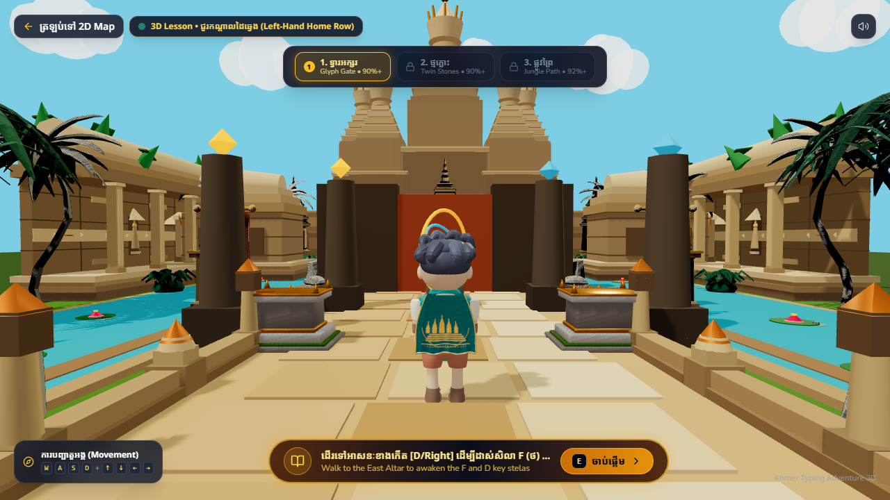 | 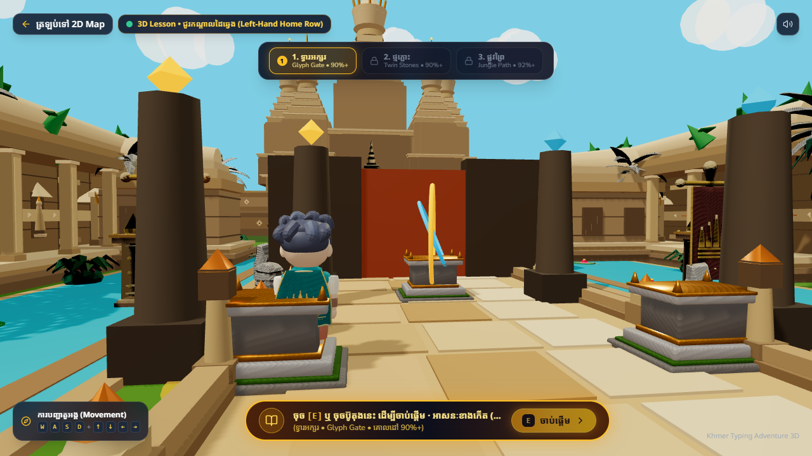 | 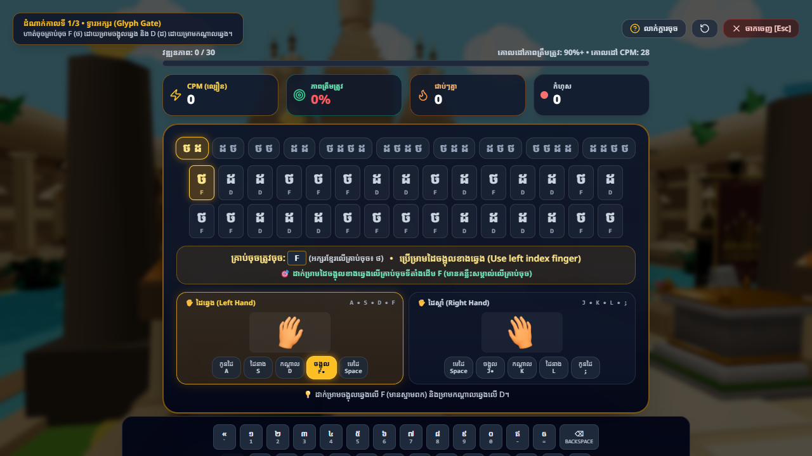 | 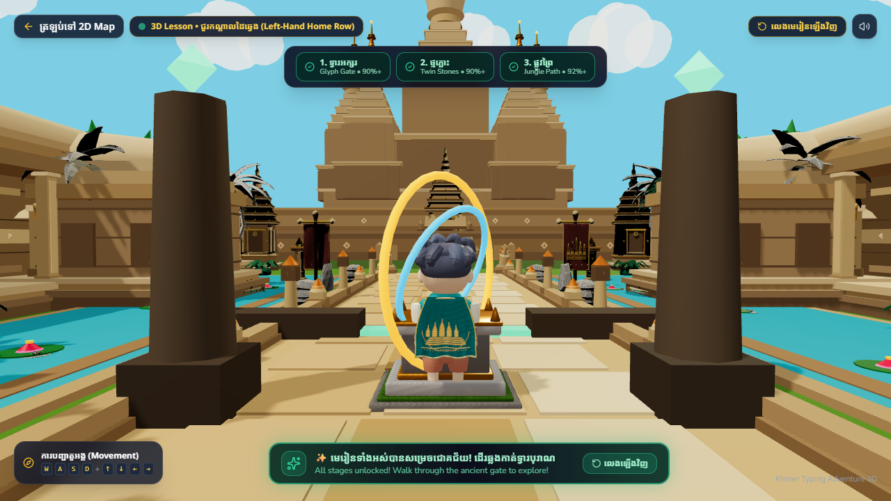 |

### Level 2: Enchanted Lotus Garden
| Garden Overview & Blooming Lotus Pads |
|---|
| 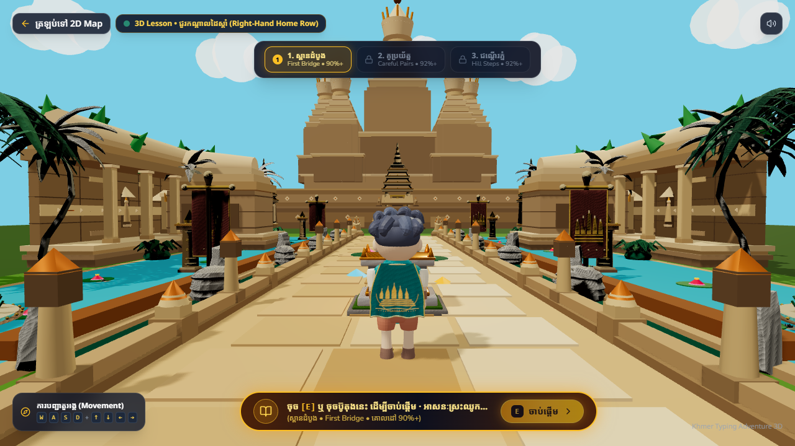 |

### Level 3: Angkor Twin Bridges
| Misty Chasm Overview | Bridgehead Typing | Mid-Chasm Cantilever Arches | Royal Keystone |
|---|---|---|---|
| 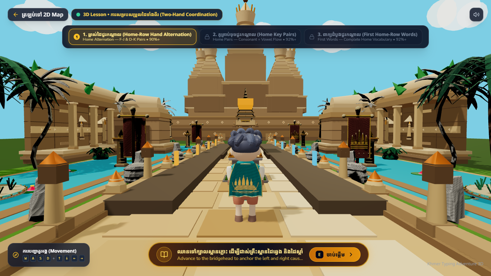 | 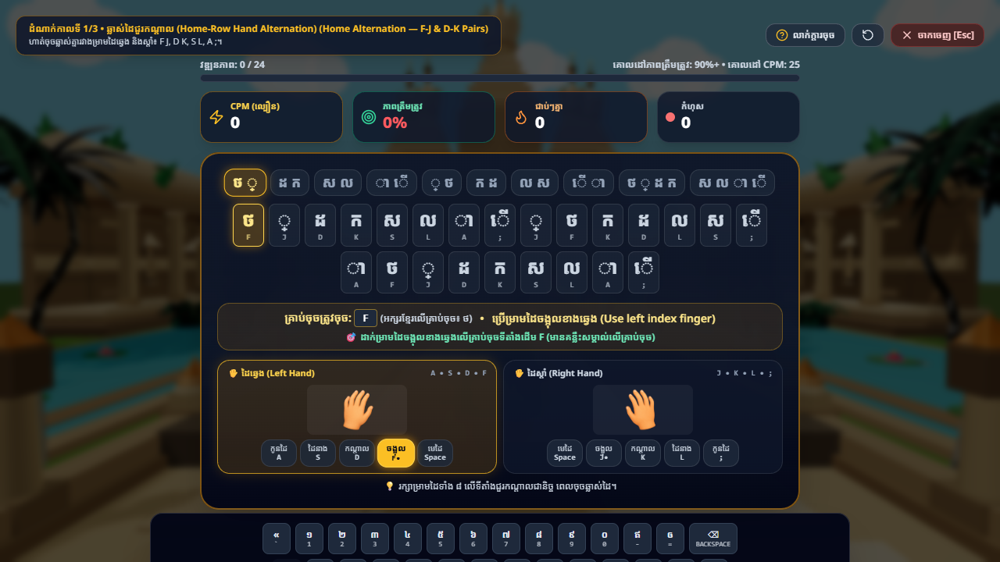 | 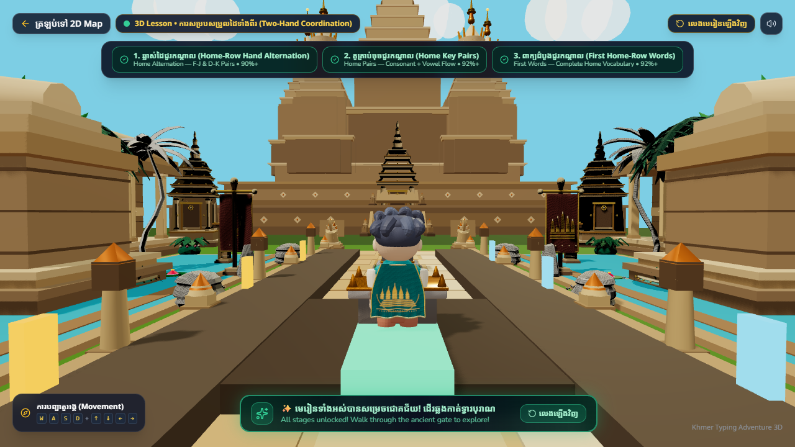 | 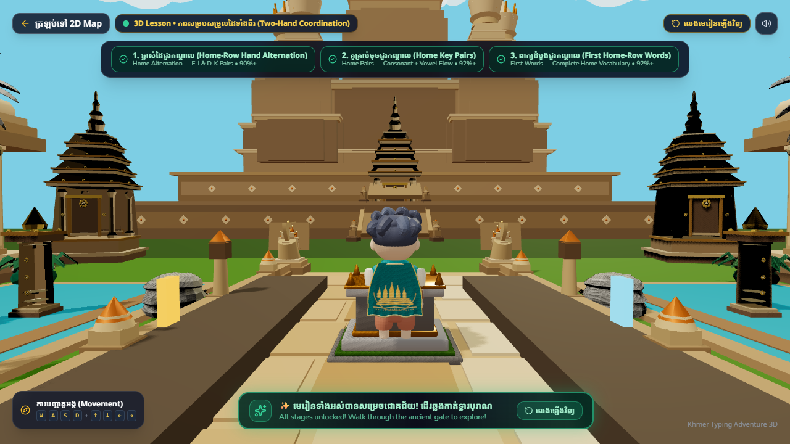 |

### Level 4: Jungle Crossroads
| Crossroads Junction & Branching Trails |
|---|
| 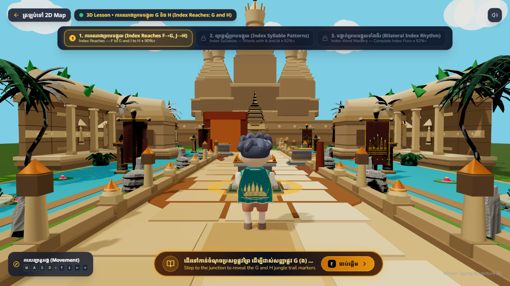 |

### Level 5: Climbing Temple Tower
| Stepped Pyramid Base ($Y=0\text{m}$) | Base Typing Mode | Terrace 1 ($Y=2.2\text{m}$) | Summit Overlook ($Y=4.4\text{m}$) |
|---|---|---|---|
| 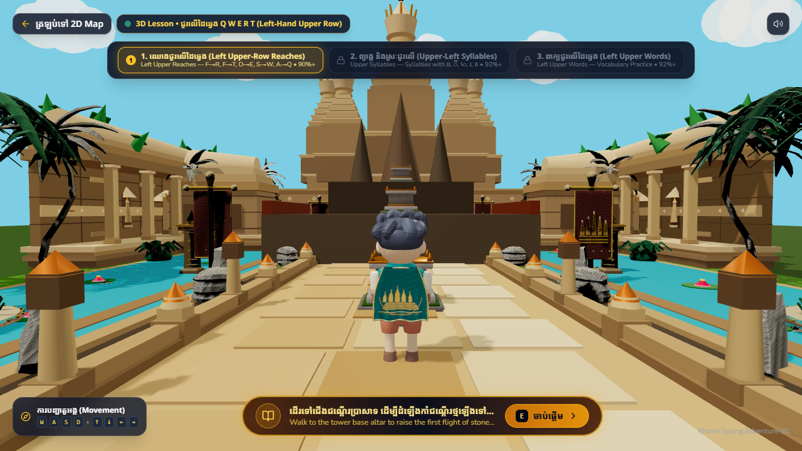 | 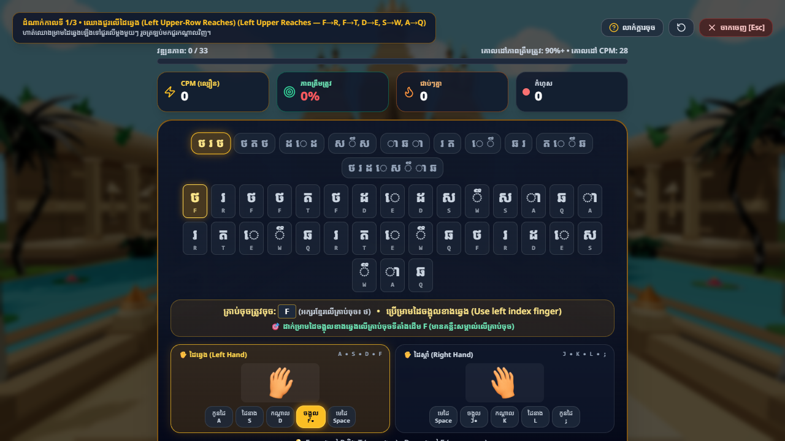 | 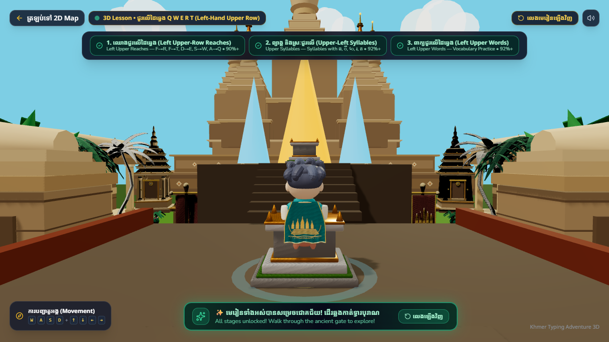 | 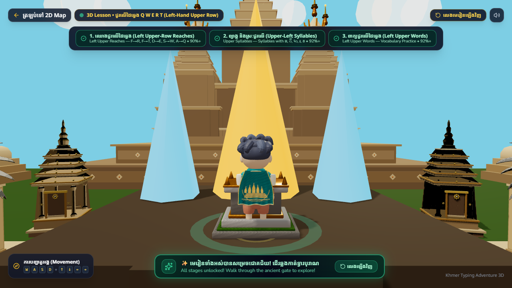 |

### Level 6: Sky Platforms
| Floating Celestial Platforms in Mid-Air |
|---|
| 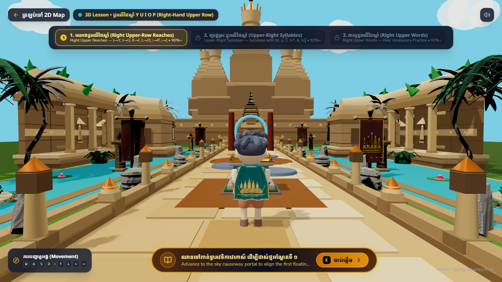 |

### Level 7: Crystal Cave
| Subterranean Cavern & Luminescent Crystals |
|---|
| 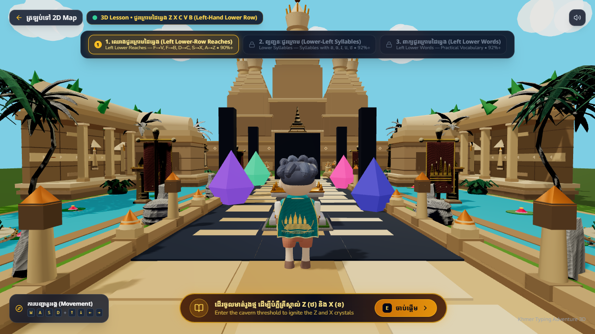 |

### Level 8: Sacred River Crossing
| Baray Water Channel & Moored Dragon Barge |
|---|
| 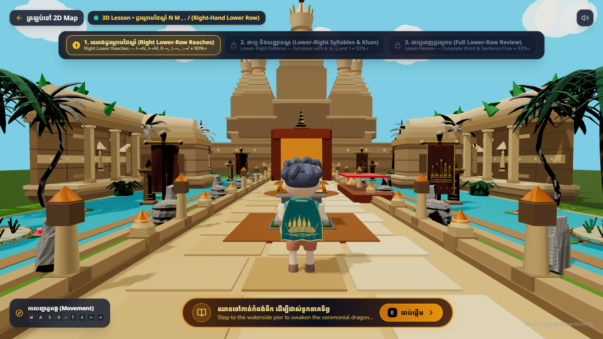 |
